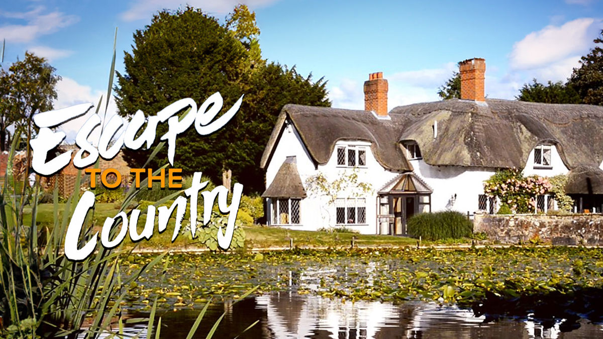
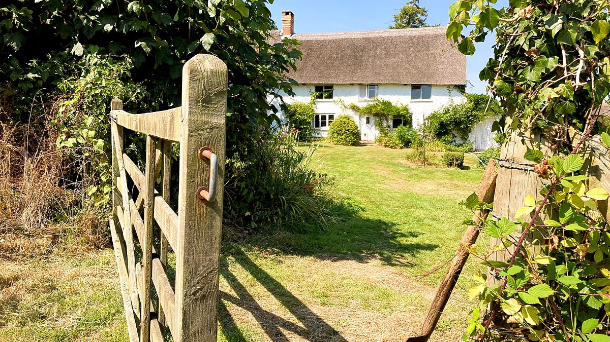
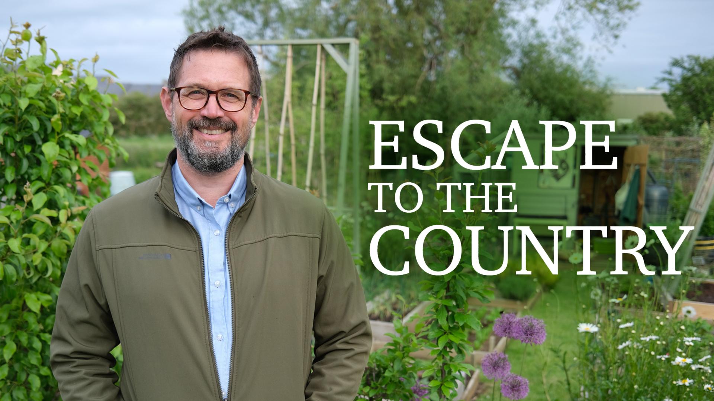

最近看了英国乡村住宅节目《Escape to the Country》，越看越觉得有意思。主持人带着买家走进一栋栋乡村住宅，有些是几百年历史的老宅，有些藏在绿树环绕的村庄里，还有些坐落在开阔的田野边，带着宽敞的花园、古老的石墙和安静的乡间小路。买家一边参观，一边想象未来的生活。看着看着，仿佛自己也跟着他们走进了英国乡村。

英国的乡村住宅与加拿大很不一样。那些老房子并不一定宽敞，有的房间低矮，木梁裸露在屋顶下，石墙保留着岁月留下的痕迹。壁炉、木地板、老式窗户和弯曲的楼梯，构成了独特的居住气息。房屋周围常有修剪整齐的草坪、花坛、果树和小菜园。村庄里的道路不宽，房屋彼此相邻，教堂、酒馆、小商店和住宅共同构成了延续数百年的乡村生活。

在那里，房子不仅仅是遮风避雨的建筑，也像一本翻开了许多页的历史书。墙壁见过不同年代的主人，门前的小路走过一代又一代村民。即使房屋经过现代化改造，许多旧建筑仍然保留着原来的结构和外观。生活在这样的地方，似乎每天都能感受到时间缓慢流动的样子。

加拿大的乡村则有另一番景象。这里土地宽广，住宅之间往往相隔很远。小镇周围是农田、草原、森林和湖泊，独立屋通常带有较大的院子，车库、地下室和停车空间也是生活中很实际的部分。房屋不一定有悠久历史，却更强调实用、保温和适应漫长冬季。开车出门是日常，买东西、看医生、拜访朋友，常常都要走上一段距离。

英国乡村让人欣赏的是历史与建筑，加拿大乡村吸引人的则是空间与自由。一个地方的魅力，往往并不取决于房子有多大，而在于房子与周围环境之间形成了怎样的关系。

看着节目里的买家寻找乡村住宅，我也不由得想到退休以后的生活。如果有一天不再需要每天按时上班，不必为了通勤选择城市里的住宅，那么居住地点是否可以换一种思路？也许不需要一栋很大的房子，更不需要豪华装修。一栋面积不大的独立屋，有厨房、卧室、浴室，有一个可以晒太阳的小院子，已经足够。

春天可以在院子里种些蔬菜，夏天坐在树荫下喝茶，秋天整理花园，冬天在屋里读书、看电影。房子不必承担全部生活的内容，它只是一个安稳的落脚点。天气合适的时候，可以开车出门，沿着公路旅行，看看不同的小镇、湖泊和山脉。累了就找个地方停下来，享受一段安静的日子；想回家了，就开回自己的小房子，休息几天，再准备下一次出发。

这样的生活，在加拿大似乎更容易实现。辽阔的土地给了人更多选择，许多小镇仍然保留着独立屋和私人院落。不过，选择地点也不能只看房价。冬季气候、道路状况、医疗设施、供暖费用、房屋维护和日常购物，都关系到晚年的生活质量。年轻时可以为了风景住得偏远，年纪大了以后，离医院和基本服务太远，就可能成为负担。

英国乡村住宅节目还有一个让我感兴趣的地方，就是它很少把生活描绘成单纯的物质享受。主持人带着买家走进房间，打开窗户，看看花园，介绍周围的村庄和交通。买家考虑的除了价格，还有每天醒来看到什么景色，周末可以去哪里散步，附近有没有商店，房子是否适合自己的生活习惯。每一栋房子都对应着一种不同的日常生活。

人到了某个年龄，或许会逐渐改变对住宅的看法。年轻时希望房子越大越好，地段越繁华越好，周围有购物中心、餐馆和各种娱乐设施。到了退休阶段，反而可能更珍惜安静、阳光、空气和一块属于自己的土地。房间少一些，打扫起来轻松；院子大一些，可以种花种菜；房子不必昂贵，但要可靠，冬天温暖，夏天舒适。

当然，英国乡村的老宅有它独特的美，加拿大乡村的小房子也有自己的长处。前者让人感受到历史沉淀，后者给人留下自由活动的空间。一个人可以欣赏英国老房子的木梁、石墙和壁炉，也可以喜欢加拿大小镇的宽阔院落、车库和乡间公路。生活不必只有一种标准答案。

看完节目，最令人向往的也许不是某一栋价值几十万英镑的豪宅，而是那些买家在乡村住宅里寻找的生活状态。窗外有树，门前有花园，远处是田野，日子不必匆忙。房子不需要向别人证明什么，只要能够容纳自己的生活，便有了它真正的价值。

或许，退休生活最好的样子，就是有一个随时可以回去的家，也有一条随时可以出发的路。家让人安心，远方让人保持好奇。一个人既不必把余生全部交给一栋房子，也不必永远漂泊在路上。能在两者之间自由选择，能够出门看世界，也能够回到自己的院子里种几棵蔬菜，这样的日子，已经足够令人期待。
